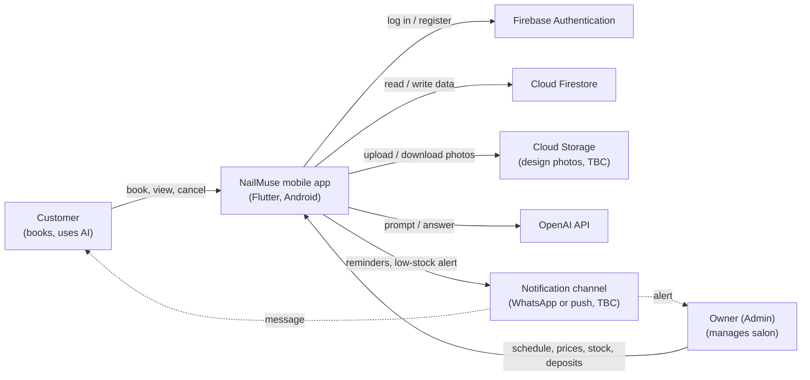
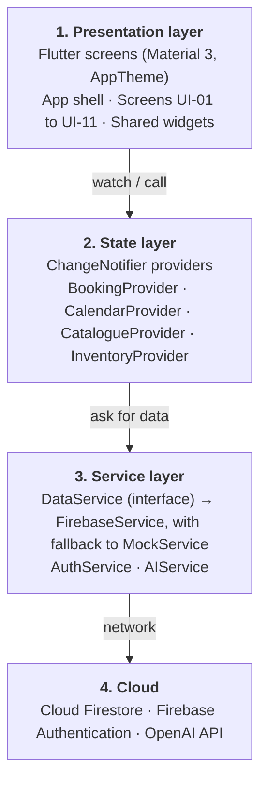
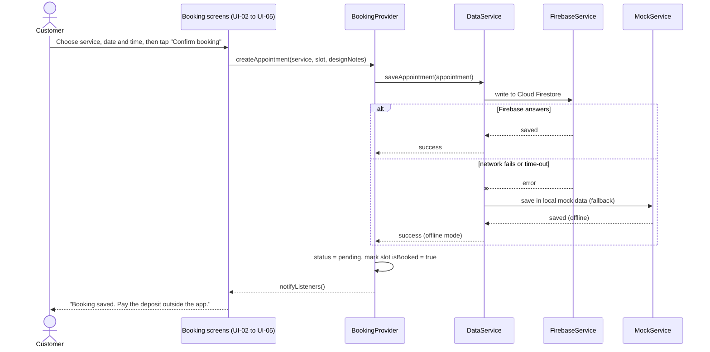
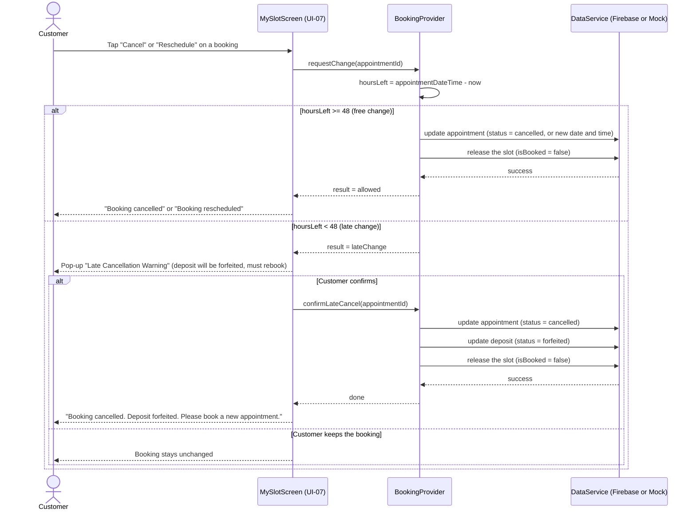
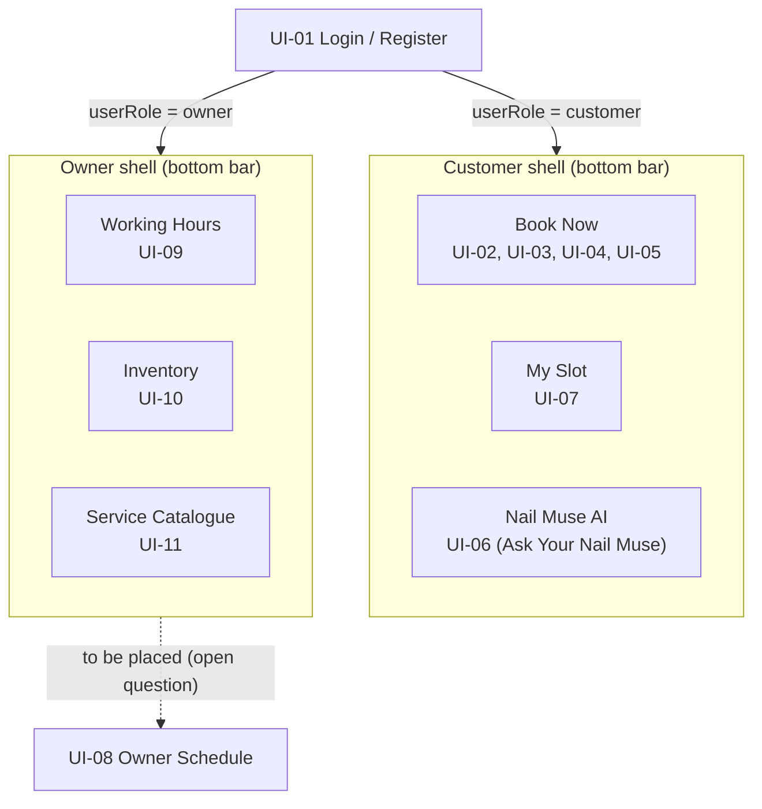

# 2. System Overview

## 2.1 System Description
nägel: Nail Business Management System (NBMS) is an Android app for a home-based manicure salon in Batu Kawa, Kuching, owned by Ms. Michelle Anak Ini. A customer chooses a service, a date and a time, adds a design preference or photo, and pays a deposit of at least 20% outside the app. The salon owner (also called Admin) manages working hours, bookings, deposits, prices and supplies. Three AI helpers give design recommendations, price estimates and answers to common questions (FR-08 to FR-10, FR-AI-01 to FR-AI-04). The app is built with Flutter and uses Firebase for login and data.

## 2.2 Design Goals
Table 2.1 lists the design goals of NBMS and the requirement behind each goal.

| Goal | What it means in NBMS | Related requirement |
| --- | --- | --- |
| Consistency | All screens use one theme (AppTheme), one set of shared widgets and the same enum words | STYLE_GUIDE.md |
| Reliability | The app never shows a blank screen when the network fails. It falls back to hardcoded baseline data | NFR-04 |
| Security | Role-based access. No API keys in the code | NFR-02 |
| Maintainability | Layered design: screens, providers, services. A screen never calls Firebase directly | NFR-06 |
| Simplicity | Appointment-only, single studio, small number of screens | Scope (SRS 1.2) |

*Table 2.1: Design goals*

## 2.3 Architecture Summary
NBMS is a layered mobile client with a serverless backend (Firebase). The app has four layers: Presentation (screens), State (ChangeNotifier providers), Service (DataService with Firebase and mock implementations, AuthService, AIService) and Cloud (Cloud Firestore, Firebase Authentication, OpenAI API). There is no custom server. A screen asks a provider, the provider asks a service, and the service talks to the cloud.

## 2.4 System Context Diagram
Figure 2.1 shows the app and everything outside it. The two user classes are the Customer and the Owner. The app talks to Firebase Authentication (log in), Cloud Firestore (data), the OpenAI API (AI answers) and a notification channel (reminders and low-stock alerts). Cloud Storage for design photos (FR-05) and the reminder channel (FR-06: WhatsApp or push) are marked TBC because they are not confirmed with the client yet.

*Figure 2.1: System context diagram of NBMS*

---

# 3. Architectural Design

## 3.1 System Architecture Diagram
Figure 3.1 shows the four layers and how they depend on each other. Each layer only talks to the layer below it. The layout follows the team's State Management Provider Contract.

*Figure 3.1: System architecture of NBMS*

## 3.2 Component Breakdown
- **App shell (`main.dart`):** Starts the app, applies `AppTheme.light`, and opens the customer shell or the owner shell from `userRole`. Interacts with `AuthService` and the providers.
- **Screens (UI-01 to UI-11):** Show data and send user actions to providers. They never call Firebase directly.
- **Shared widgets:** Buttons, cards, chips, status labels, empty state and error banner with a Retry button.
- **BookingProvider (FR-01, FR-03, FR-11, FR-13):** Creates, cancels and reschedules appointments, applies the 48-hour rule, tracks deposit status.
- **CalendarProvider (FR-02):** Available slots, owner working hours, blocked slots.
- **CatalogueProvider (FR-04, FR-09):** Services and prices, and the AI price estimate.
- **InventoryProvider (FR-07, FR-14):** Supplies, quantities and the low-stock check.
- **DataService (interface), FirebaseService, MockService:** One set of methods with two implementations. The provider calls `DataService`. `FirebaseService` reads and writes Cloud Firestore. `MockService` returns the hardcoded baseline data from `mock_data.dart` when a live request fails.
- **AuthService (NFR-02):** Log in, register, current user and role (Firebase Authentication).
- **AIService (FR-08 to FR-10, FR-AI-03):** Calls the OpenAI API and returns a retry message if the call fails.
- **Models (`src/lib/models/`):** `UserModel`, `ServiceModel`, `AppointmentModel`, `AvailabilitySlotModel`, `InventoryItemModel` and the string constants in `enums.dart`.

## 3.3 Technology Stack
Table 3.1 lists the technologies used to build NBMS.

| Area | Technology |
| --- | --- |
| Mobile app | Flutter, Dart 3, Material 3 |
| State management | Provider (ChangeNotifier) |
| Authentication | Firebase Authentication |
| Database | Cloud Firestore |
| AI | OpenAI API (GPT) |
| Design | Figma (wireframes), AppTheme with Lora and Poppins fonts |
| Source control and CI | GitHub, GitHub Actions (`flutter analyze`, `flutter test`) |
| Target platform | Android 8.0 and above, signed APK v1.0.0 |

*Table 3.1: Technology stack*

## 3.4 Data Flow and Control Flow
### 3.4.1 Booking flow with offline fallback
Figure 3.2 shows how a booking is saved. The provider calls `DataService`. If Firebase answers, the booking is saved there. If the network fails or times out, the service falls back to the mock data so the screen does not break (NFR-04). After saving, the booking status is `pending` and the slot is marked `isBooked = true`.

*Figure 3.2: Sequence diagram of booking an appointment*

### 3.4.2 Cancel or reschedule with the 48-hour rule
Figure 3.3 shows cancelling or rescheduling (FR-03). A booking can be changed free of charge only if at least 48 hours are left before the appointment. If less than 48 hours are left, the app shows the pop-up "Late Cancellation Warning". When the customer confirms, the deposit status becomes `forfeited` and the customer must book a new appointment. If the customer keeps the booking, nothing changes.

*Figure 3.3: Sequence diagram of cancelling or rescheduling a booking*

---

# 4. Detailed Design
This section describes the user interface shell components. The business logic of FR-02 and FR-03 is described by the feature owners in the same section.

## 4.1 App Shell
- **Responsibilities:** Start the app, apply the theme, show UI-01 first, and open the correct shell after login.
- **Interfaces/APIs:**
  - **Inputs:** `userRole` of the logged-in user (`customer` or `owner`).
  - **Outputs:** the customer shell or the owner shell.
  - **Error Handling:** If the role is missing or unknown, return to UI-01 and show "Please log in again".
- **Data Structures:** `UserModel` (`userId`, `userName`, `userEmail`, `userPhone`, `userRole`, `userCreatedAt`).
- **Algorithms/Logic:** After login: `userRole == owner` opens the owner shell, otherwise the customer shell. Only customers can register. The owner account is created by the team in Firebase.
- **State Management:** `ChangeNotifierProvider` objects are created once at the top of the app (`MultiProvider`). The screens read them with `context.watch` and `context.read`.

## 4.2 Navigation (Bottom Navigation Bars)
- **Responsibilities:** Move between the main screens of each user class. Icons are added later, so text labels are used for now.
- **Interfaces/APIs:**
  - **Inputs:** the selected tab.
  - **Outputs:** the matching screen.
  - **Error Handling:** Not applicable.
- **Data Structures:** A list of tabs per shell.
- **Algorithms/Logic:** See Table 4.1.
- **State Management:** The selected tab index is kept in the shell widget.

Table 4.1 lists the tabs of each shell and the screens they open. Figure 4.1 shows the same navigation as a diagram.

| Shell | Tab | Screens |
| --- | --- | --- |
| Customer | Book Now | UI-02 Service Catalogue, UI-03 Date and Time, UI-04 My Design (AI), UI-05 Confirm and Deposit |
| Customer | My Slot | UI-07 My Bookings |
| Customer | Nail Muse AI | UI-06 AI Assistant (heading "Ask Your Nail Muse") |
| Owner | Working Hours | UI-09 Availability Calendar |
| Owner | Inventory | UI-10 Inventory |
| Owner | Service Catalogue | UI-11 Service and Price Management |

*Table 4.1: Bottom navigation tabs*

*Figure 4.1: Navigation map of the customer shell and the owner shell*

UI-08 Owner Schedule is not on the owner bar yet. This is an open question (Section 4.5).

## 4.3 Theme and Shared Widgets
- **Responsibilities:** Make every screen look like the same app.
- **Interfaces/APIs:**
  - **Inputs:** `AppTheme.light` and `AppColors` from `src/lib/core/theme/app_theme.dart`.
  - **Outputs:** consistent colours, fonts and component styles.
  - **Error Handling:** If a font file is missing, Flutter uses the default font and the app still works.
- **Data Structures:** `AppColors` (Night Bordeaux, Cool Horizon, Ivory Mist, helper colours).
- **Algorithms/Logic:** Rules in Table 4.2.
- **State Management:** None (the theme is constant).

Table 4.2 lists the shared UI components and the rule for each one.

| Component | Used for | Rule |
| --- | --- | --- |
| App bar | Screen title | Night Bordeaux background, white Lora title |
| Filled button | Main action | Height 48, pill shape |
| Card | Service, booking, supply | Radius 16, white, light border |
| Choice chip | Date, time, category | Selected = Cool Horizon with Night Bordeaux text (never white text) |
| Status label | Booking and deposit status | Uses the enum words (`pending`, `confirmed`, `completed`, `cancelled`) |
| Low-stock tag and banner | UI-10 and UI-08 | Shown when `itemQuantity <= itemMinThreshold` |
| Empty state and error banner | No data, AI or network error | Message with a Retry button (FR-AI-03, NFR-04) |
| Pop-up dialog | Late Cancellation Warning, low-stock alert | Short text and two clear buttons |

*Table 4.2: Shared UI components*

## 4.4 Shared Strings (Enum Standardisation)
All string values are defined once in `src/lib/models/enums.dart` and used by models, Firestore queries and screens: appointment status (`pending`, `confirmed`, `completed`, `cancelled`), user role (`customer`, `owner`), service category (`gel`, `extensions`, `care`), inventory category (`polish`, `tips`, `charms`, `tools`) and deposit status (`pending`, `verified`, `forfeited`).

